# marathon-like deepseek harness skin

给 DeepSeek Harness 做的一套酸性工业皮肤。

从 Marathon 的大色块、硬边界和工业排版开始：字标切开，按钮收方，工作区放上三位数字。正文留出空间，切换时让颜色沿着界面的方向走。

`v2.4.11` · `Windows / macOS` · `Harness 0.2.0-rc.2 / 0.2.1（含 RC）`

[下载 2.4.11](https://github.com/yasneg616/marathon-like-deepseek-harness-skin/releases/tag/v2.4.11) · [安装与回退](docs/INSTALL.md) · [本次更新](docs/RELEASE-v2.4.11.md)

**v2.4.11**：适配 Windows Harness 0.2.1-rc.5，修正右侧栏和字号按钮的跨构建类名识别；可选的 Windows 标题栏适配器新增对已核对哈希的 rc.5 安装包支持。首次启动曾有一次色条与经典布局混杂，刷新后恢复，另两次全新启动未复现；详见[更新说明](docs/RELEASE-v2.4.11.md)。

**v2.4.10 正式版**：解决不同系统、不同构建的 CSS Module 哈希不一致导致的皮肤样式失效；采用 [Siyuan-Zhao770707 的 PR #4](https://github.com/yasneg616/marathon-like-deepseek-harness-skin/pull/4) 主要实现。macOS 增加竖向窗口按钮，部分操作需要系统辅助功能权限，仍欢迎 Mac 用户实机反馈。详情见 [更新说明](docs/RELEASE-v2.4.10.md)。

[历史预发行版 v2.4.10-rc.1](https://github.com/yasneg616/marathon-like-deepseek-harness-skin/releases/tag/v2.4.10-rc.1) 采用不同的 macOS 窗口留白方案，不代表正式版的实现。


## Marathon 彩蛋


这次彩蛋更新的灵感来自视频评论区的观众 **Eidhsg**，感谢他的建议！

皮肤里新增了许多围绕 **Marathon IP memes** 的彩蛋，留给熟悉这个系列的你慢慢发现。彩蛋中的图形、字形和文案均为原创，未使用游戏的原始界面、标志或音频。

这些彩蛋与工作区色条状态动画也包含在 **v2.4.11 安装包**中，下载后即可在 Harness 中安装，无需构建源码。

## 2.4.6：工作区收进色条

**新版色条。** 113px 侧栏，两列色条错位排列。每个工作区保留自己的编号和识别色；悬停或键盘聚焦时，会话卡片从旁边展开。黑夜是黑底白字，白天是白底深字。

**工作区管理与颜色。** 色条编号下方的「…」打开 Harness 原生菜单，可重命名或删除工作区，删除仍需原生确认。悬浮卡片底部可选择工作区颜色、输入六位 HEX 色值或恢复默认；配色按工作区在本机保存，顶部当前工作区同步更新，深浅颜色会自动选择清楚的文字色。中文、英文及混排名称统一侧转 90°，从下往上读。


**经典工作区随时切回。** 在「调色盘 → 工作区样式」选择经典或新版，立即生效并在本机保存。经典侧栏的四个按钮改成紧凑的 2×2，新会话保持高亮，让列表多留一些空间。2.4.6 也修复了经典单列表切回新版色条失效的问题，重新加载时会修正旧的冲突状态。


**MORE 跟着调色盘走。** 底部条纹、更多入口和四色遮罩使用当前配色。展开和收起都有转场，再点一次或按 Escape 收回；菜单使用实色背景，修复展开后的黑色遮挡。窄窗口也保留入口。


**输入框和窗口按钮。** 消息输入框恢复矩形边框、切角、信号灯与聚焦反馈。右上角的最小化、最大化／还原、关闭按竖向排列；Windows 原生操作需要安装 Release 中的可选标题栏适配器，现已支持核对过哈希的 `0.2.1-rc.3`。


**产出文件随明暗模式换色。** 浅色模式的文档、图片产出卡片与变更摘要使用浅色卡面，避免黑框黑字；工作区当前项的白色小箭头加上深色包边，在各种识别色上都看得清。


图片和 **22 组 GIF** 录自独立展示页，都是 **1×**。样式、字体、配色、编号排布与动效来自正式插件；页面外壳、工作区、会话名称和用量计数使用虚构数据。展示页不连接 Harness。早期 GIF 保留对应动效的局部展示，当前工作区布局以上方 2.4.6 图片为准。

## 先看颜色和字

这组夜间配色只有四个角色：酸性绿抓住操作和当前状态，蓝色标出交互，石墨黑留给阅读，灰白色撑起正文。四块遮罩也直接取这四种颜色。

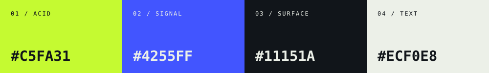

字标用矩形切割和断口。GRID 放在开屏、HARNESS 字样和大号数字上，SIGNAL 放在编号与辅助信息里；中文正文保留原来的字体和字号。

**开屏。** 色板从下方铺上来，横线走完，整块向上退去。

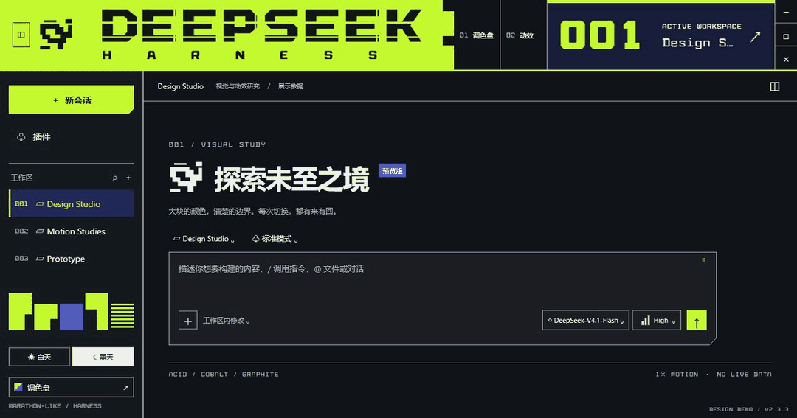

**换一组颜色。** 调色盘改完，标题、侧栏、正文和遮罩一起更新。Max 的残影也跟着当前配色走。


**白天与黑天。** 阅读区跟着模式换，字标和边界仍然清楚。两套颜色分别保存。

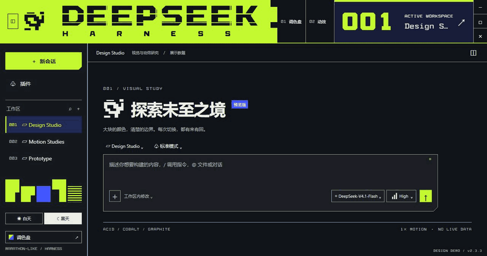

## 用量也有自己的颜色

侧栏底部换成 **18 列 × 7 行** 的 token 活动图。一格一天，显示最近 18 周；今日用细边框标出，空白日期是灰色。四种调色盘颜色依次落在阅读背景、正文色、交互色和酸性色上。

三个默认界限是 **100 万 / 1000 万 / 5000 万**。每日总量超过一个界限，今日方块就换到下一种颜色；换调色盘或明暗模式，活动图也一起更新。

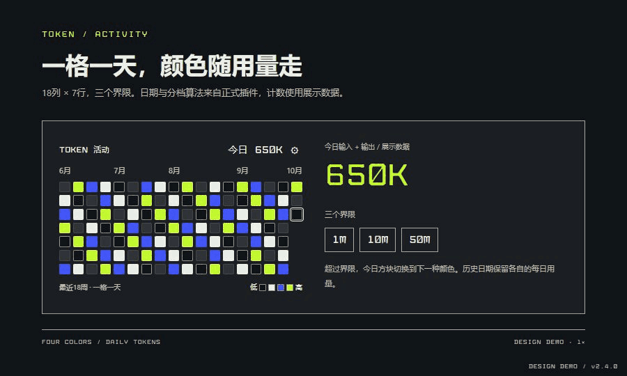

正式插件统计整个应用所有工作区、会话与子代理的**输入 + 输出 token**，按北京时间划分日期。输入包含缓存，推理已经包含在输出里；分叉继承记录排除，避免重复计数。悬停或键盘聚焦可以查看当天的输入、输出与总量。

点击图旁齿轮，可保存三个递增的界限。恰好等于界限时保留当前档，超过后才换色；侧栏收起后留下今日用量小按钮和设置入口。

点击 **TOKEN 活动** 标题可单独折叠或展开日历，收起后保留今日用量与齿轮设置。折叠状态会在本机自动保存，重启或切换侧栏后仍然保留；按钮支持键盘 Enter / 空格操作。

`v2.4.3` 修复皮肤白天模式与 Harness 原生深色模式不一致时，用户消息气泡依然深色、文字却变深色的可读性问题。气泡背景和高亮现跟随皮肤色板；新增交叉主题和自定义配色对比度测试。

`v2.4.2` 更新了 DSH 0.2.1 的插件版本声明，支持新版启动时的兼容检查，并保留 Windows 运行窗口图标功能。

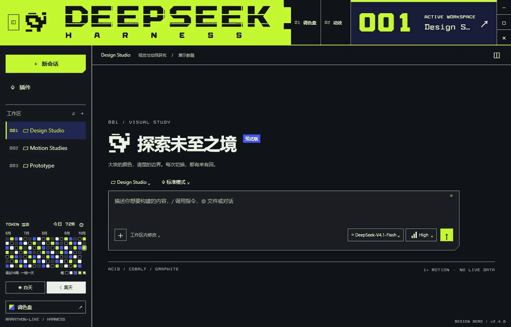

## 切换要有来有回

遮罩的动作很简单：先盖住旧画面，停一小拍，再沿原路退回。侧栏走水平方向，页面、菜单和弹窗走竖直方向。

**左侧栏。** 从左向右盖过去，再向左揭开。展开和收起用同一套动作。

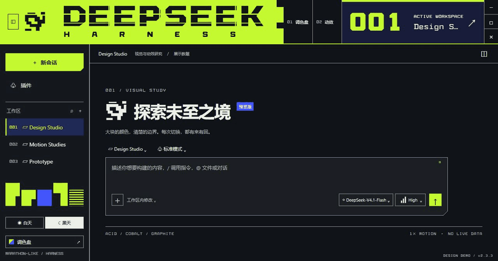

**右侧栏。** 方向正好镜像；文件预览沿着右侧栏的方向切换。

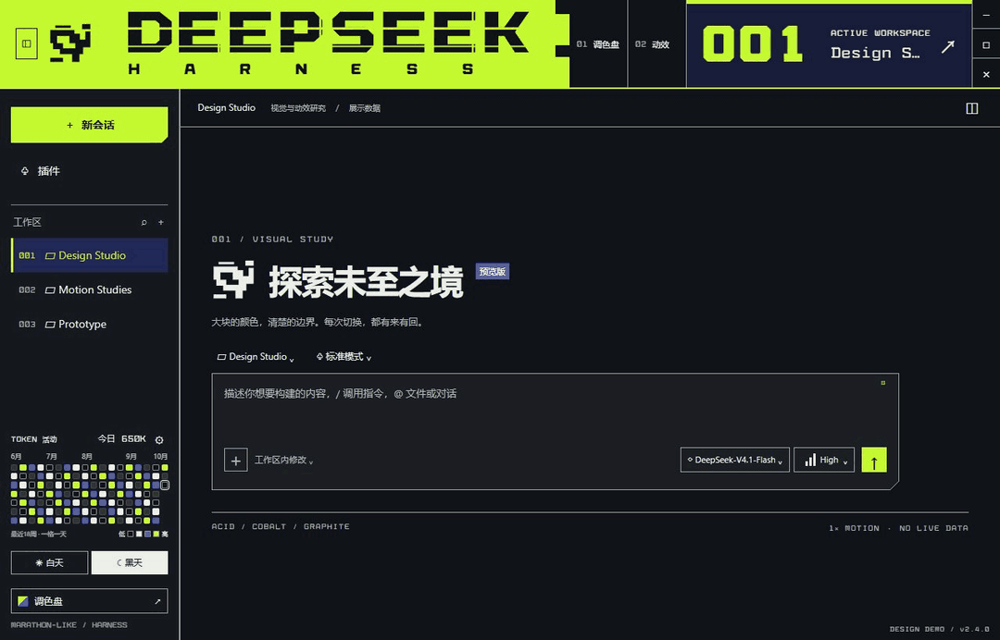

**整页切换。** 旧页面留到色板完全覆盖，再露出新页面。

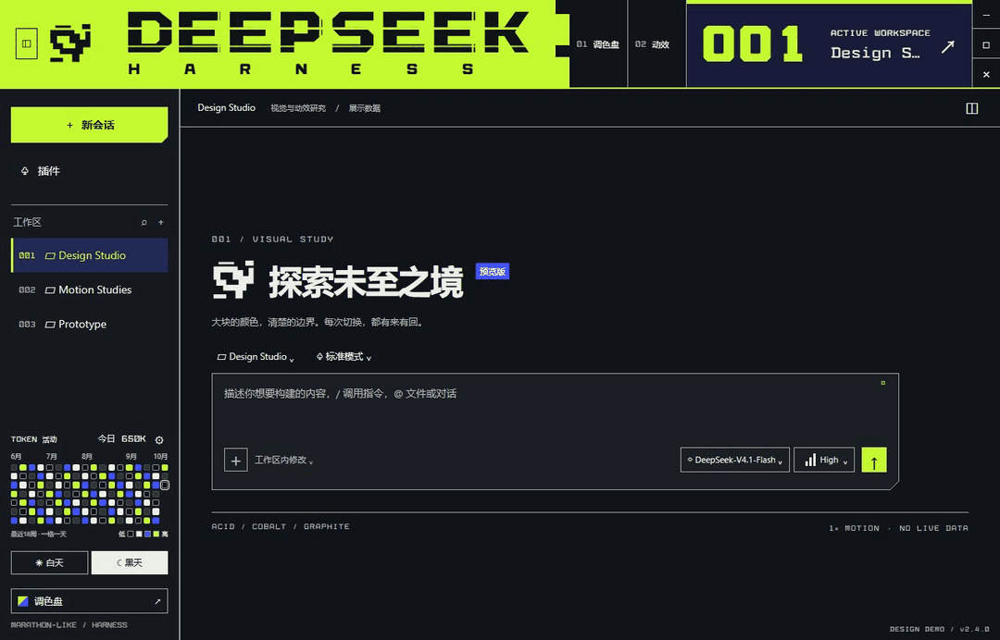

**文件标签。** 切到另一份文件，内容区走一次相同的往返。

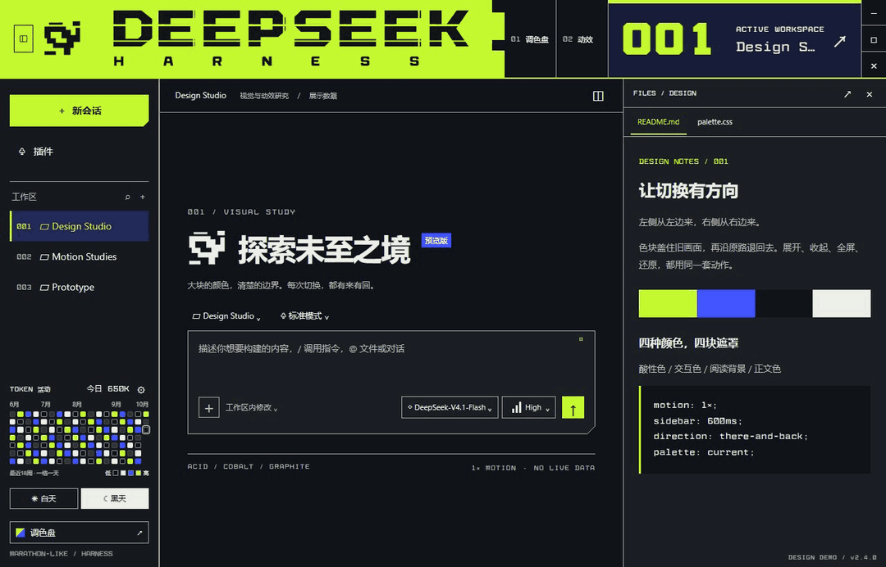

## 编号和小动作

工作区编号跟真实列表的次序走。大号数字切换时做一次扫描校准，名称直接更新；数字动起来，旁边的文字保持安静。

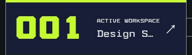

侧栏收起后，`001`、`002`、`003` 留在窄栏里。可以直接选工作区，当前项高亮，悬停能看到名称。

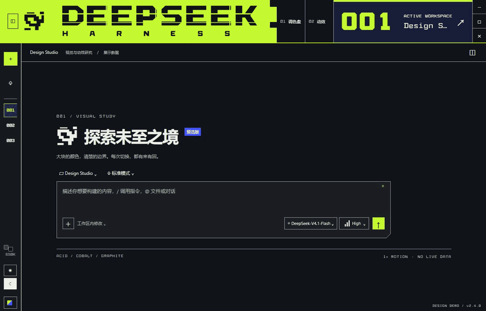

按钮的反馈落在四个角上：悬停时 **3px 厚角** 收拢，按下时从中心填满，再外扩一圈轮廓。

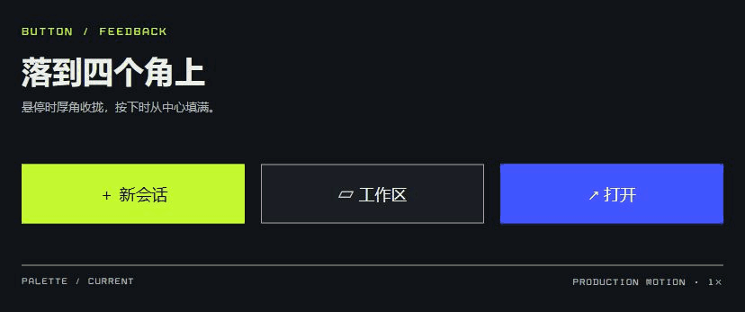

输入框得到焦点，边线接上，厚角落位，右上角的小灯亮起。正文和光标留在原处。

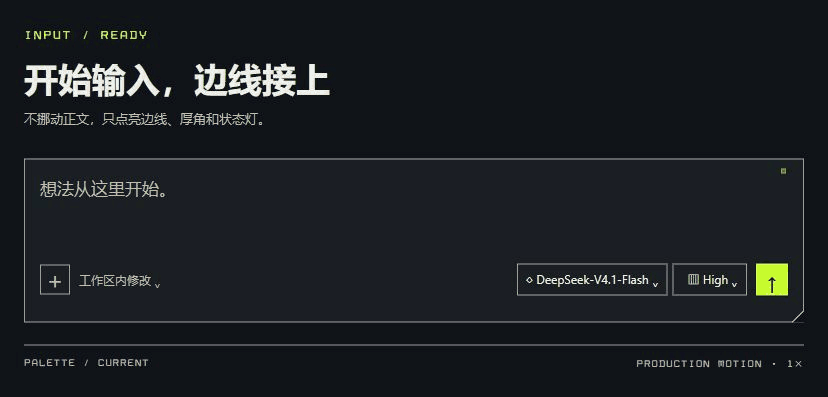

状态变化用四个小方块接力亮一下。同一状态不会反复播放。

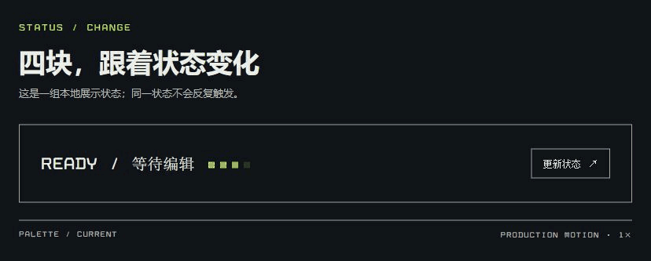

## 菜单也用这套动作

模型菜单和调色盘弹窗，打开时盖住再揭开，关闭时原路收回。转场做完就撤掉临时图层。

**模型与思考强度。** 模型、等级和保存动作仍由 Harness 提供。

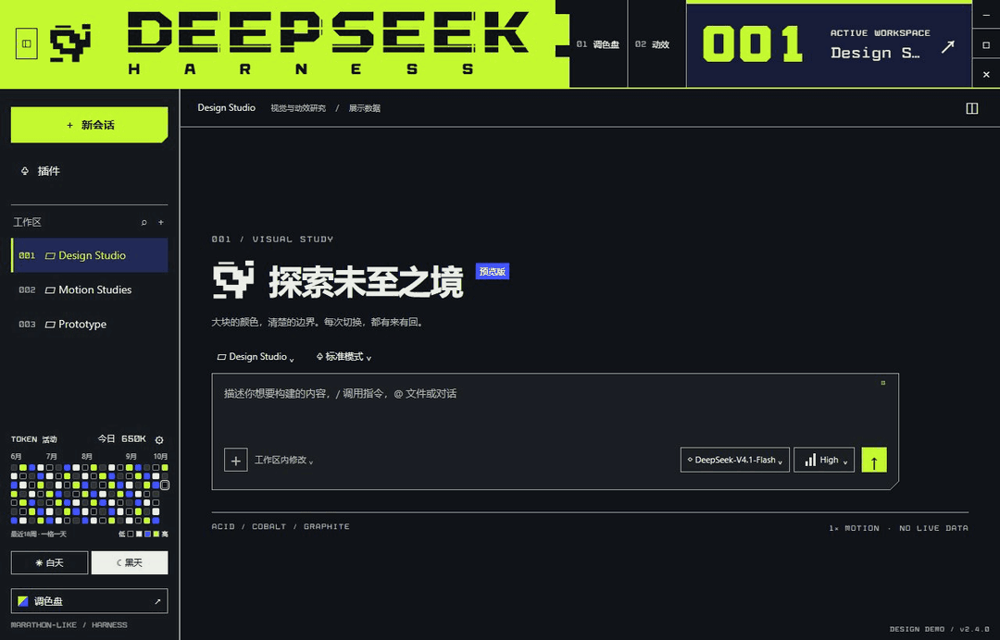

**调色盘。** 色块只在弹窗范围里走，后面的页面保持原位。


## High → Max

平常的轨道保持稳定。从 High 往 Max 推，震动和残影才逐渐变强；到 Max 后持续，拖回 High 就收住。

三轮选型后留下了这三种。这里分开看，插件里随机出现；一次蓄力保持同一种，回到 High 或更低后再重新抽选。

**01 / 同频震颤**

滑块和轨道一起发紧，短距离的双层残影跟着震动。

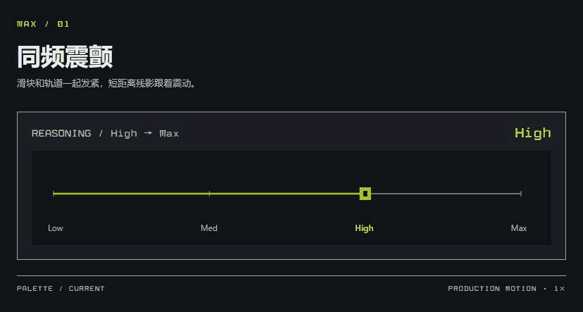

**02 / 残像追赶**

残影拉长，速度线逐渐展开，能看见滑块后面拖出的几层延迟。

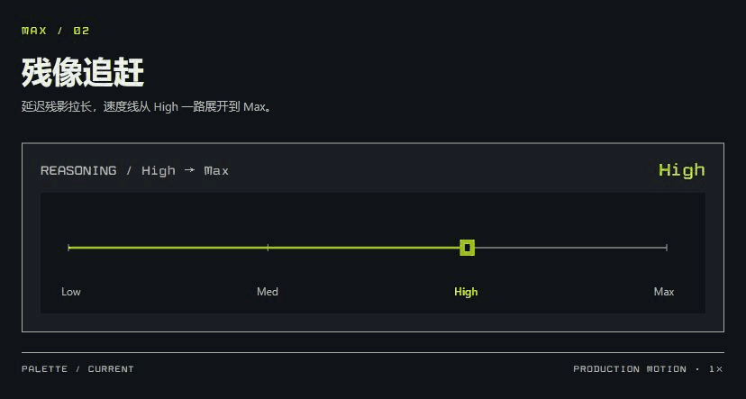

**03 / 错帧暴走**

轨道分片错位，重影把边缘撕开。幅度随位置增加，配色随调色盘变化。

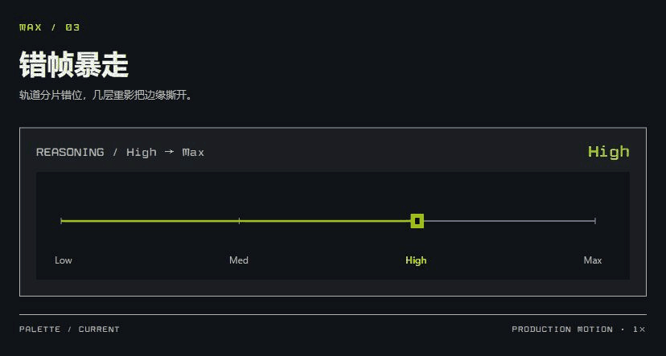

动效有「完整 / 克制 / 停止」三档，也跟随系统的“减少动态效果”。停止时仍保留静态 Max 标识。

## 工作区色条状态

新版色条会跟随原生会话状态循环提示：工作中是流动斜纹加扫描线，等待确认是黑框慢闪，完成但还没打开查看时扫过一道亮光并显示 ✓。动效设为「停止」时只保留静态标记。

## 安装

1. 下载 [v2.4.11 正式版](https://github.com/yasneg616/marathon-like-deepseek-harness-skin/releases/tag/v2.4.11) 中的 `dsh-industrial-acid-skin-2.4.11.tgz`。无需 Node.js。
2. Harness「插件 → 添加插件」，粘贴完整下载链接，或输入已下载文件的本机绝对路径：

   ```text
https://github.com/yasneg616/marathon-like-deepseek-harness-skin/releases/download/v2.4.11/dsh-industrial-acid-skin-2.4.11.tgz
   ```

3. 启用插件，按提示重启。Windows 升级到 rc.5 后如需竖排窗口按钮，请下载新版可选适配器并按 [说明](docs/DESKTOP-ADAPTER.md) 校验宿主版本与哈希。macOS 最小化与全屏控制可能需要系统辅助功能权限。

Windows rc.5 已在隔离配置下验证皮肤交互和可选窗口适配器。macOS 窗口交互仍需实机反馈。

想自己拨一拨滑块、试一下切换，可以运行仓库里的展示页：

```sh
node tools/serve-showcase.cjs
```

打开 [新版工作区展示](http://127.0.0.1:19411/docs/showcase/next.html) 或 [动效展示页](http://127.0.0.1:19411/?controls=1)。字体与 SVG 内置，皮肤资源可以离线加载。

设计方向参考 [Marathon](https://marathonthegame.com/zh-chs)。这是非官方皮肤，与 DeepSeek、Bungie 或 Marathon 没有隶属关系；不包含 Marathon 官网代码或游戏素材。

[MIT License](LICENSE) · [GRID / SIGNAL 字体来源](assets/fonts/SOURCE.md)
